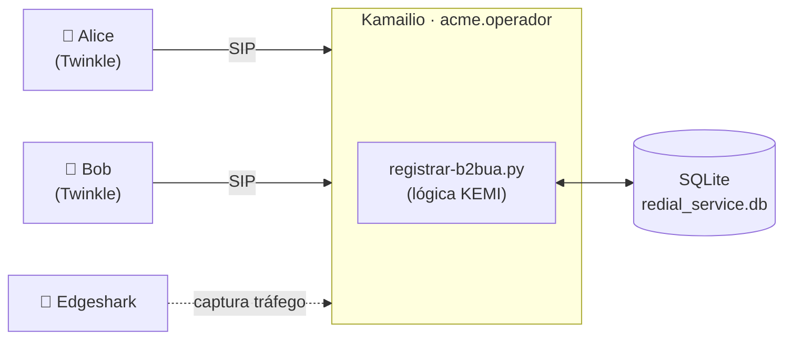
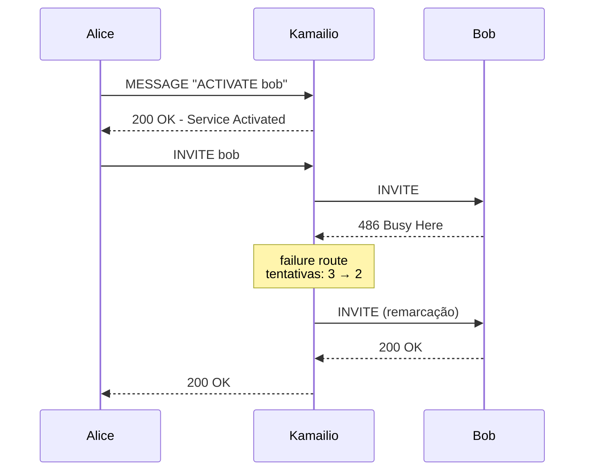
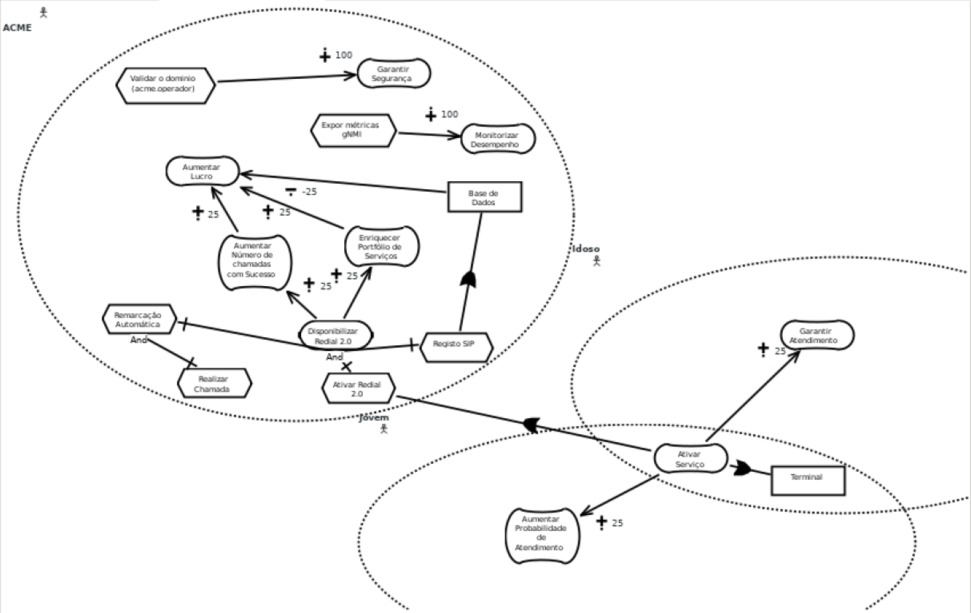

# 📞 Redial 2.0 — Serviço de remarcação automática em SIP

> Projeto de **IGRS** · Grupo 4 · 2025

Serviço de telefonia VoIP construído sobre o **Kamailio**, com a lógica escrita em **Python (KEMI)**. Quando um utilizador liga para um contacto da sua lista de "redial" e a chamada falha (ocupado, sem resposta ou indisponível), o servidor **remarca sozinho** até 3 vezes.


---

## ✨ Funcionalidades

| Funcionalidade | Como funciona |
|---|---|
| **Registo restrito ao domínio** | Só aceita `REGISTER` de `acme.operador`; qualquer outro domínio recebe `403 Forbidden` |
| **Ativar o serviço** | `MESSAGE` para `sip:redial@acme.operador` com `ACTIVATE <user1> <user2> …` |
| **Desativar o serviço** | `MESSAGE` com `DEACTIVATE` |
| **Remarcação automática** | Em `486 Busy`, `408 Timeout` ou `480 Unavailable`, volta a tentar até **3 vezes** |
| **Persistência** | Listas de redial e estatísticas guardadas em **SQLite** |
| **KPI** | Contador global de ativações do serviço (`total_activations`) |

---

## 🏗️ Arquitetura



Tudo corre em contentores Docker numa rede bridge (`acme`), com o Kamailio acessível pelo alias `acme.operador`.

---

## 🔁 Fluxo de uma chamada com redial



Os diagramas completos de cada cenário estão em [`Diagramas/`](Diagramas):

| Cenário | Diagrama |
|---|---|
| Chamada normal | [chamada_normal.png](Diagramas/chamada_normal.png) |
| Ativar o serviço | [ativar_o_servico.png](Diagramas/ativar_o_servico.png) |
| Ciclo de redial | [ciclo_redial.png](Diagramas/ciclo_redial.png) |
| Falha sem o serviço | [falha_sem_o_servico.png](Diagramas/falha_sem_o_servico.png) |
| Desativar | [desativar.jpeg](Diagramas/desativar.jpeg) |

---

## 📂 Estrutura do repositório

```
├── Lab3/
│   ├── compose_lab3_b2bua.yaml   # Kamailio + Alice + Bob
│   ├── compose_lab3_sems.yaml
│   ├── compose-edgeshark.yaml    # captura de tráfego entre contentores
│   ├── twinkle.dockerfile        # imagem dos softphones
│   ├── sems.dockerfile           # servidor de media SEMS (announcement)
│   ├── scripts/
│   │   ├── registrar-b2bua.py    # ⭐ lógica do serviço
│   │   ├── Alice.cfg / Bob.cfg   # perfis SIP dos terminais
│   │   └── sems.conf
│   └── scripts_aux/              # kamailio.cfg, arranque e áudio
├── capturas/                     # ficheiros .pcapng de cada cenário
├── fotos/                        # capturas de ecrã (REGISTER, ACTIVATE, …)
├── Diagramas/                    # diagramas de sequência
└── GRL_final.jucm / GRL.jpeg     # modelo de objetivos (GRL)
```

---

## 🚀 Como correr

**Pré-requisitos:** Docker com Compose v2 e um servidor X (os softphones Twinkle têm interface gráfica, via `DISPLAY=host.docker.internal:0`).

```bash
cd Lab3

# 1. Construir a imagem dos softphones
docker build -f twinkle.dockerfile -t twinkle:igrs_01 .

# 2. Arrancar Kamailio + Alice + Bob
docker compose -f compose_lab3_b2bua.yaml up -d

# 3. (Opcional) Arrancar o Edgeshark para capturar o tráfego SIP
docker compose -f compose-edgeshark.yaml up -d
```

### Testar o serviço

1. Regista a Alice e o Bob nos respetivos Twinkle
2. A partir da Alice, envia uma mensagem para `redial@acme.operador` com:
   ```
   ACTIVATE bob
   ```
3. Liga para o Bob com ele ocupado ou sem atender, e o Kamailio remarca sozinho
4. Para desligar o serviço:
   ```
   DEACTIVATE
   ```

---

## 🔬 Capturas de tráfego

A pasta [`capturas/`](capturas) tem os `.pcapng` de cada cenário, prontos a abrir no **Wireshark**:

`register` · `registerInvalido` · `deregister` · `ACTIVATE` · `DEACTIVATE` · `Chamada normal` · `Chamada com redial`

---

## 🎯 Modelo de objetivos

O serviço foi modelado em **GRL** (Goal-oriented Requirement Language) com o jUCMNav: [`GRL_final.jucm`](GRL_final.jucm).


